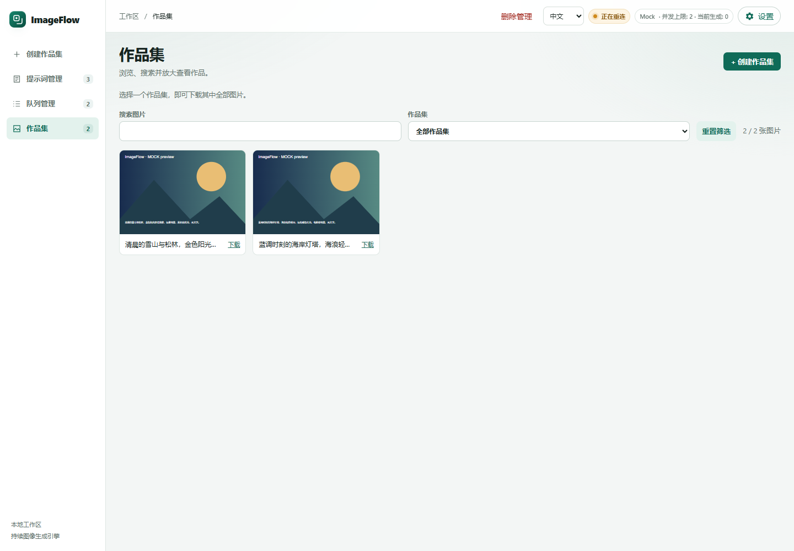
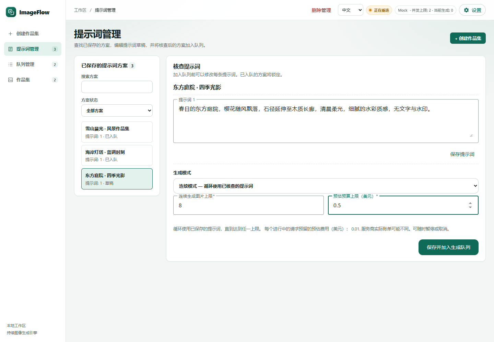
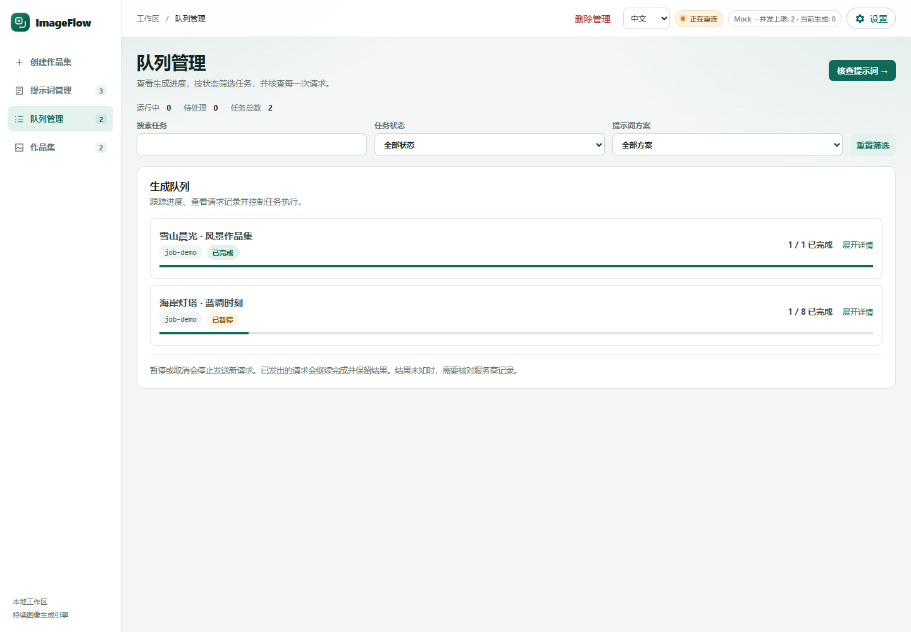
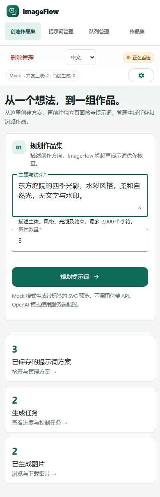

# ImageFlow

中文 | [English](README.en.md)

ImageFlow 是一个可复用、优先本地运行的**持续图像生成引擎**。从主题规划提示词，审核并保存，再交由可控队列生成图片、浏览和下载作品。上层智能体、故事系统和世界模拟器可以通过公共 API 使用引擎。

技术栈：**.NET 10 / ASP.NET Core Web API / EF Core / SQLite / Angular 22.3.0 / Angular Material / NgRx Signal Store 22**。后端采用模块化单体，API 与 Worker 可在同一进程运行；前端依赖版本由锁文件固定。

## 功能概览

- **规划与审核**：根据主题规划 1–20 条提示词，持久化后逐条编辑，确认后加入队列。
- **有限与持续生成**：有限模式按方案执行；持续模式循环已保存的提示词，同时限制图片数量和预估预算，可手动暂停或取消。
- **持久化队列**：SQLite 保存提示词快照、任务状态、请求尝试、重试时间、输出和原始用量元数据。
- **并发与恢复**：支持 1–8 个未完成图像 API 请求的动态并发限制、429 退避、Retry-After、重启恢复及不确定结果人工核查。
- **作品管理**：搜索、筛选、灯箱预览、单图下载、作品集 ZIP 下载和统一的两步删除管理。
- **实时工作区**：SSE 更新任务进度，支持简体中文、英文及移动端布局。
- **服务商适配**：提示词规划与图像生成使用独立接口，包含 Mock、官方 OpenAI 和显式配置的 OpenAI 兼容服务。

默认使用 **Mock**，生成带标识的 SVG 预览，**不是 AI 生成图片**。启动和默认自动化测试不会调用付费 API；启用真实服务商后，主动规划或入队会产生付费请求。

## 界面预览

以下截图均使用当前版本前端的中文界面重新截取，通过隔离的中文演示数据展示功能，未调用付费 API。作品集图片为 Mock 样式的 SVG 演示预览，不代表真实模型生成质量；“正在重连”表示截图时的更新连接状态。

### 作品集：搜索、筛选与下载

按任务筛选结果，点击图片打开灯箱、查看提示词并下载。选择作品集后可下载该任务当前已保存图片的 ZIP。



### 提示词管理：先审核，再生成

查找已保存方案、编辑草稿，并选择有限或持续模式。持续模式同时限制图片数量和预估预算。



### 队列管理：查看进度与请求详情

按方案或状态筛选任务。卡片默认折叠，展开后可查看请求记录、预估费用占用、调度操作和人工核查入口。



### 移动端：从主题创建作品集

窄屏下导航移到顶部，可输入主题、设置数量并规划提示词。



## 快速开始

需要 .NET SDK 10 和 Node.js 24.15+（24.x）。已有测试环境：SDK 10.0.400、Node 24.15.0、npm 11.12.1。同一数据库只运行一个 API 实例，目前不支持分布式或多 Worker 实例部署。

在仓库根目录执行：

```powershell
dotnet restore
dotnet build
dotnet test --no-restore
npm ci --prefix src/frontend/imageflow-web
npm test --prefix src/frontend/imageflow-web
npm run build --prefix src/frontend/imageflow-web
```

在一个终端启动 API。显式指定 Mock 可覆盖已有本地服务商配置，避免演示时调用付费 API：

```powershell
$env:Engine__Provider = 'Mock'
dotnet run --project src/backend/ImageFlow.Api --launch-profile http
```

在另一个终端启动前端：

```powershell
npm start --prefix src/frontend/imageflow-web
```

打开[前端工作区](http://localhost:4200)，输入主题、规划提示词，在提示词管理页审核后保存并入队。API 地址为 [localhost:5080](http://localhost:5080)，提供[健康检查](http://localhost:5080/health)和 [OpenAPI JSON](http://localhost:5080/openapi/v1.json)。Angular 开发代理将 `/api` 转发到后端。

默认数据目录为 `src/backend/ImageFlow.Api/data/`，包含 SQLite 数据库和 `images/` 文件。备份前停止 API，将数据库与图片一起保存。可通过 `Engine__DataDirectory` 指定绝对路径；相对路径以 API 内容根目录为基准。不要提交运行数据或密钥。

## 工作区使用

| 页面 | 路由 | 主要操作 |
| --- | --- | --- |
| 创建作品集 | `/create`（默认） | 输入主题、数量，规划成功后打开方案 |
| 提示词管理 | `/prompts?plan=<id>` | 搜索方案、筛选草稿/已入队、编辑保存、设置上限并入队 |
| 队列管理 | `/queue?plan=<id>` | 搜索和筛选任务、查看进度、暂停/恢复/取消、核查不确定结果 |
| 作品集 | `/gallery?job=<id>` | 浏览、搜索、预览和下载，按生成任务筛选 |

工作区共享一次初始化和 SSE 订阅。页面切换保留未保存的提示词、创建草稿及方案生成设置；完整刷新仅恢复服务端已保存数据。方案/任务 URL 筛选可收藏，文本及状态筛选属于当前会话。入队成功后跳转到对应队列，打开管理页面本身不会触发生成或重试。

首次访问按浏览器主语言选择中文（`zh` 系列）或英文。页头可即时切换，手动选择保存在本地存储中，切换不丢失表单内容。用户提示词和服务商原始错误保留原语言。

灯箱支持前后按钮、左右方向键、缩略图、Escape 关闭及下载。浏览顺序以打开时的筛选结果为准，实时新增图片不会打乱顺序，关闭后焦点返回原图。

页头分别显示持久化的**并发上限**和当前 Running 的**正在生成**请求数。Live/实时连接标记表示浏览器与后端的更新连接状态。

### 设置、删除与下载

页头“设置”保存图像模型、尺寸/比例、质量、模型适用的复杂度、并发及单次请求美元预估费用。设置存入 SQLite；图像配置和费用预估用于新任务，已有任务保留快照。更改图像配置后应重新审核并保存预估。并发调整立即影响后续调度，降低上限不会中断已发出的请求。

服务商允许自定义尺寸时，提供横竖屏、16:9/9:16 和 4K（3840×2160、2160×3840）等预设。GPT-Image-2.5 超过 2560×1440 总像素数的预设标为“实验性”，包括 2048×2048；选择预设不表示网关一定支持，也不会触发付费探测。

通过页头“删除管理”统一按提示词方案删除：先搜索并选择，再审核方案身份、图片预览及影响数量，最后确认永久删除。会删除所选方案及其任务、图片、用量和核查历史，保留其他方案和引擎设置。运行中的图像请求会阻止删除；过期选择不会被静默缩减为部分批次。文件清理持久化并可在重启后重试。删除不撤销服务商收费，请先导出所需图片和审计记录。

作品集 ZIP 包含所选任务当前所有已保存图片，不受界面搜索词影响，不包含其他任务或在途输出。空作品集返回 404，文件缺失或不可读返回 409，避免提供不完整压缩包。下载不触发规划或生成。

## 配置真实图像服务

ASP.NET Core 使用 `Engine__...` 环境变量。[.env.example](.env.example) 列出配置项，但程序**不会自动加载 `.env` 文件**。也可使用被 Git 忽略的 `src/backend/ImageFlow.Api/appsettings.Local.json`；环境变量和命令行覆盖该文件，本地配置不会复制到构建或发布输出。

密钥保存在环境变量或安全的本地配置中，不要写入 Angular、提交文件、日志或 SQLite 设置。`Engine:CredentialEnvironmentVariable` 指定密钥变量名，默认 `OPENAI_API_KEY`，其值优先于本地 `Engine:ApiKey`。兼容服务使用独立且显式命名的密钥变量。

### 官方 OpenAI

以下为当前实现的配置示例，实际可用性取决于账号权限与服务商能力：

```powershell
$env:OPENAI_API_KEY = '<你的密钥>'
$env:Engine__Provider = 'OpenAI'
$env:Engine__PromptModel = 'gpt-6-luna'
$env:Engine__ImageModel = 'gpt-image-2.6-flare'
$env:Engine__ImageSize = '1024x1024'
$env:Engine__ImageQuality = 'medium'
$env:Engine__ImageComplexity = 'high'
$env:Engine__OutputFormat = 'png'
$env:Engine__ProviderProfile = 'openai'
$env:Engine__CredentialEnvironmentVariable = 'OPENAI_API_KEY'
$env:Engine__MaxConcurrency = '2'
$env:Engine__MaxAttempts = '3'
dotnet run --project src/backend/ImageFlow.Api --launch-profile http
```

模型能力集中在 `ModelCatalog` 验证。当前适配器使用 Responses JSON Schema 规划和 Images API 生成 PNG，模型与升级说明见[模型升级文档](docs/model-upgrade.md)。质量为 `low`、`medium`、`high`、`xhigh`、`max`；2.6 复杂度为 `low`、`medium`、`high`，2.5 应选 `none`，请求中省略复杂度参数。尺寸为明确的 `WIDTHxHEIGHT`：边长是 16 的倍数且不超过 3840，宽高比不超过 3:1，总像素为 655,360–8,294,400。不支持 `auto` 或非 PNG 输出，也不为旧模型名称提供替换别名。

服务商、密钥引用和允许能力属于服务端配置，修改后需重启。已有 SQLite 设置优先于启动图像默认值；`Engine__MaxConcurrency` 只初始化新数据库。启动不会试生成图片。

### 显式配置 OpenAI 兼容服务

按实际能力调整以下内容，放入被忽略的 `appsettings.Local.json`，并在 API 终端设置 `IMAGEFLOW_GATEWAY_API_KEY`：

```json
{
  "Engine": {
    "Provider": "OpenAICompatible",
    "ProviderProfile": "my-gateway-v1",
    "BaseUrl": "https://your-provider.example/api/native/v1/",
    "CredentialEnvironmentVariable": "IMAGEFLOW_GATEWAY_API_KEY",
    "PromptModel": "gpt-6-luna",
    "ImageModel": "gpt-image-2.6-flare",
    "ImageSize": "1024x1024",
    "ImageQuality": "medium",
    "ImageComplexity": "high",
    "OutputFormat": "png",
    "CompatibleCapabilities": {
      "PromptModels": ["gpt-6-luna"],
      "ImageModels": ["gpt-image-2.6-flare"],
      "Sizes": ["1024x1024"],
      "Qualities": ["medium"],
      "Complexities": ["high"],
      "Formats": ["png"]
    }
  }
}
```

只声明网关确实支持的选项。示例不代表已验证任何网关，`/models` 列出模型也不证明其参数兼容性。适配器要求 Responses JSON Schema 和 Images base64 PNG；仅在确实支持上述尺寸约束时启用 `CompatibleCapabilities:CustomDimensions`。2.5 复杂度声明为 `none`。提示词和对应凭据会发送到指定端点，自动重定向已禁用。切回 `Engine__Provider=Mock` 可恢复免费预览。

仅在明确接受付费时运行真实服务验证：

```powershell
dotnet build
python scripts/test-provider.py --allow-paid
```

脚本至多创建一个持久化方案、生成一张图，只允许一次图像尝试且不自动重发。临时 API 使用 5084 端口，数据库、图片、日志和不含凭据的报告写入 `.cache/`。旧模型的历史验证不代表当前模型已验证；默认测试始终使用 Mock 或拦截请求。

## 队列与费用安全

提示词先保存再入队。一个方案最多创建一个任务，重复提交 `POST /jobs` 返回已有任务；入队后锁定提示词并保存不可变快照。持续模式循环这些提示词，不会反复调用文本规划。

暂停和取消停止后续调度，已发送请求允许完成并保存结果，无法撤销收费。重启时 Pending、RetryWaiting 继续处理，Running 请求与尝试转为 **Unknown**，不会盲目重发。

仅明确的 HTTP 429 拒绝自动重试，受最大尝试次数、指数退避及较长的 Retry-After 秒数/日期约束。网络中断、超时、408、5xx 或输出写入失败属于不确定结果，不自动重试。明确拒绝则失败。先写图片再提交完成状态，期间崩溃可能留下需人工核对的孤立文件；网络请求不放在长数据库事务中。

持续模式必须设置 `maxImages`（1–1000）及正数 `budgetUsd`，并先保存正数的单次请求预估费用（最多六位小数）。调度器按需创建请求，达到数量或预估预算任一上限即停止，不能直接恢复为无上限运行。有限模式也可设置预算。Unknown/Failed 会让持续任务进入 NeedsAttention。

每次请求前，在同一 SQLite 提交中保存 Running 状态、尝试和预估费用预留。Completed、Unknown 保留占用；明确拒绝（含 429）释放占用，重试须重新预留。并发请求的预留共同计入上限，重启不重置数量或预算。旧迁移任务标为 Unpriced，不追溯编造费用。

任务保存服务商/配置档、端点、凭据引用、适配器版本、模型参数、尝试上限及预估费用快照，不保存密钥值。默认设置变更不重映射已有任务；所需配置档、能力或凭据引用不可用时，在发送前以 NeedsAttention 停止。同一引用下可轮换密钥。

**预估费用占用不是实际账单，也不是服务商收费保证。** 原始测量用量单独记录。预算只覆盖图像请求，不覆盖任务创建前的规划请求；真实支出限制还需设置服务商侧额度。规划是同步调用，中断可能已产生用量但未保存方案，不会自动重试。

### 人工核查 Unknown

1. 在队列展开请求，检查提示词快照、尝试 ID、时间、服务商请求 ID、错误、用量和预留状态；等待同任务的在途请求结束。
2. 核对服务商请求、输出与账单，保存证据并确认结论：`Generated` 标记完成、保留占用且不重发（不会自动导入远程图片）；`NotGeneratedNotCharged` 仅在确认未生成且未收费后释放预估占用并暂停；`Abandon` 取消该请求并保留不确定占用。
3. 对确认未生成且未收费的请求，单独授权重试并确认可能产生新费用。请求进入 Pending，任务仍暂停；解决其他待核查项后再手动恢复。

核查绑定最新尝试 ID，重复或过期提交返回 409。证据和授权时间持久化，原 Unknown 历史保留，不提供绕过未解决 Unknown 的强制重试。释放预估费用不是账单退款。记录是本地操作审计，不代表已认证审核人身份，请勿在证据中粘贴密钥。

## REST API

应用接口统一使用 `/api/v1`：

| 方法 | 路径 | 用途 |
| --- | --- | --- |
| POST / GET | `/plans` | 规划提示词 / 列出方案 |
| GET | `/plans/{id}` | 查看持久化方案 |
| PUT | `/prompts/{id}` | 编辑未入队提示词，`{"text":"..."}` |
| POST / GET | `/jobs` | 创建 / 列出任务及尝试 |
| GET | `/jobs/{id}` | 查看任务 |
| POST | `/jobs/{id}/pause`、`/resume`、`/cancel` | 控制调度 |
| GET | `/images`、`/images/{taskId}` | 图片来源记录 / 图片文件 |
| GET | `/jobs/{id}/images.zip` | 下载作品集 |
| GET | `/tasks/{id}` | 查看请求、尝试及核查 |
| POST | `/tasks/{id}/reviews` | 提交 `{attemptId,resolution,evidence,confirmed:true}` |
| POST | `/tasks/{id}/retry` | 核查后授权 `{attemptId,confirmed:true}`，任务仍暂停 |
| GET | `/usage` | 图像尝试历史及原始测量用量 |
| GET / PUT | `/settings` | 查询 / 保存并发、预估费用及图像配置 |
| GET | `/events` | SSE，每秒发送 `jobs` 快照，重连获取当前状态 |
| POST | `/plans/bulk-delete`、`/jobs/bulk-delete`、`/images/bulk-delete` | 原子批量删除，`{"ids":["..."],"confirmed":true}` |
| DELETE | `/plans/{id}?confirmed=true` | 删除方案及关联任务、图片和历史 |
| DELETE | `/jobs/{id}?confirmed=true` | 删除任务及其图片和历史，保留方案 |
| DELETE | `/images/{taskId}?confirmed=true` | 删除图片，保留请求和用量历史 |
| POST | `/workspace/clear` | 以 `{"confirmed":true}` 清空工作区，保留设置 |

规划并创建有限任务示例（真实服务商模式下会付费）：

```powershell
$plan = Invoke-RestMethod http://localhost:5080/api/v1/plans -Method Post -ContentType application/json -Body '{"theme":"quiet coast","count":2}'
Invoke-RestMethod http://localhost:5080/api/v1/jobs -Method Post -ContentType application/json -Body (@{planId=$plan.id;mode='Finite'} | ConvertTo-Json)
```

持续任务提交 `mode='Continuous'`、`maxImages` 和 `budgetUsd`，并先通过设置保存 `estimatedCostPerImageUsd`。设置更新省略的图像字段保留原值，无效参数组合会拒绝整个更新。

## 开发、测试与部署

后端按 Domain、Application、Infrastructure、Worker 和 Api 拆分：HTTP 端点处理协议，应用服务处理规划与任务命令，Infrastructure 实现 EF 及服务商适配。Angular 使用懒加载工作区、NgRx Signal Store、类型化 HttpClient/SSE 服务和独立页面组件。详见[架构文档](docs/architecture.md)与[路线图](docs/ROADMAP.md)。

### 浏览器端到端测试

```powershell
cd src/frontend/imageflow-web
npx playwright install chromium
npm run test:e2e
```

Playwright 启动独立 Mock API 和 Angular，覆盖规划、编辑、入队、图片结果及刷新持久化，另有设置、删除、灯箱、语言和移动端场景。数据和截图写入 `.cache/`，破坏性测试使用隔离或拦截数据。先停止占用 5080/4200 的服务；可通过 `PLAYWRIGHT_CHROMIUM_EXECUTABLE_PATH` 指向已安装的 Chrome。

若 Windows 沙箱无法清理自动启动的服务进程，可手动启动使用全新 Mock 数据目录的 API 和 Angular，设置 `IMAGEFLOW_E2E_EXTERNAL=1` 后测试。后端测试使用隔离的真实 SQLite 文件，默认不发出付费请求。

### 单进程静态托管

```powershell
npm run build --prefix src/frontend/imageflow-web
New-Item -ItemType Directory -Force src/backend/ImageFlow.Api/wwwroot
Copy-Item src/frontend/imageflow-web/dist/imageflow-web/browser/* src/backend/ImageFlow.Api/wwwroot -Recurse -Force
dotnet publish src/backend/ImageFlow.Api -c Release -o .cache/publish
cd .cache/publish
dotnet ImageFlow.Api.dll --urls http://localhost:5080
```

从发布目录运行，建议用绝对 `Engine__DataDirectory` 固定数据位置。静态资源在发布时包含，不要提交复制的构建产物。当前没有身份认证，适合本地使用，对其他机器开放前需补充认证和部署加固。

### 数据迁移与模型升级

启动自动执行 `MigrateAsync`，迁移文件纳入版本管理。新增迁移：

```powershell
dotnet tool restore
dotnet ef migrations add YourChange --project src/backend/ImageFlow.Infrastructure --startup-project src/backend/ImageFlow.Api
```

带已有数据或本地配置升级前，请阅读[模型升级与执行保证](docs/model-upgrade.md)。旧的未完成任务保留供核查，不会自动改用新模型执行。

### Windows 沙箱缓存与 TLS

缓存目录受限时，在当前终端改用仓库忽略目录：

```powershell
$env:DOTNET_CLI_HOME = "$PWD/.cache/dotnet"
$env:NUGET_PACKAGES = "$PWD/.cache/nuget"
$env:NUGET_HTTP_CACHE_PATH = "$PWD/.cache/http"
$env:npm_config_cache = "$PWD/.cache/npm"
```

若 .NET TLS 返回 `SEC_E_NO_CREDENTIALS`，`scripts/nuget-proxy.py` 可在本地开发中用 Python 验证 HTTPS 后桥接 NuGet。单独启动脚本，在临时 NuGet 配置中使用 `http://127.0.0.1:8767/https/api.nuget.org/v3/index.json` 并设 `allowInsecureConnections="true"`。桥接省略要求 HTTPS 的仓库签名发现资源，不应作为常规包源；正常环境直接使用官方 NuGet HTTPS。

后续工作包括优先级/间隔调度、文本规划用量历史、基于服务商价格的预估和账单核对，详见[路线图](docs/ROADMAP.md)。原英文说明完整保留于 [README.en.md](README.en.md)。
